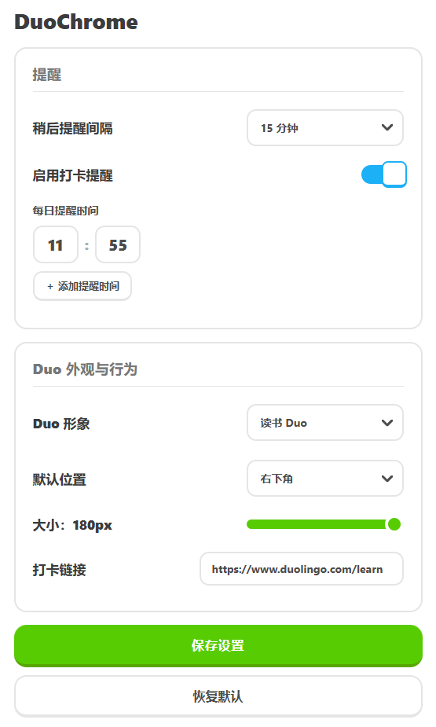

# 🦉DuoChrome

一个浏览器拓展程序，功能是让 Duo 常驻网页，并按时提醒你前往多邻国打卡。

## 截图

## 安装

在线安装：
暂无

本地安装：
在 Edge 浏览器中打开 `edge://extensions` 或者在 Chrome 浏览器中打开 `chrome://extensions` 界面，只需将下载的 `extension.zip` 文件拖放到浏览器中即可完成安装。

## 为什么？

我爱多儿。❤

## 免责声明

本项目为个人学习用途，与 Duolingo 公司无关。动画素材来源及权利说明见：
[https://www.duolingo.cn/terms](https://)

## 许可证

项目代码以 [GNU GPL v3](LICENSE) 发布。
